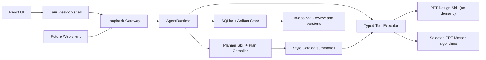

# PPT Agent V2 Architecture

## 边界

V2 的公开边界是 `AgentRuntime` 和 HTTP Gateway。Tauri、本地 Web 和未来 Order System Adapter 都通过这一边界工作，不直接操作 Planner、SQLite 或 PPT Master 文件。



## 关键职责

- `backend/ppt_agent/planning`：向模型暴露工具目录，编译并校验执行计划；模型不可直接运行 Python 或 Shell。
- `skills/ppt-agent-planner`：只描述工作流选择、依赖、恢复和 Review 终点，不包含具体页面美术规则。
- `skills/ppt-design`：只允许 `design.compose`、`svg.generate`、视觉检查和设计修订工具加载。
- `style-library/*/design.md`：内置风格的唯一事实来源；Planner 只读取摘要，设计工具读取完整契约。
- `skills/ppt-style-extractor`：把已脱敏的 PPTX 视觉证据归纳成可复用设计规则，不读取原文内容。
- `backend/ppt_agent/style_library`：统一管理内置/用户风格、版本哈希、PPTX 导入、脱敏参考页、草稿校验与发布。
- `backend/ppt_agent/tools`：把类型化 V2 工具映射到筛选后的 PPT Master 算法，向 Core 隐藏迁移细节。
- `backend/ppt_agent/core`：会话、计划、执行、版本、Artifact 和状态机的唯一协调者。
- `backend/ppt_agent/gateway`：兼容现有 UI 的可移植 HTTP/SSE 接口。
- `vendor/ppt_master_runtime`：保留文档转换、项目管理、SVG 质量、PPTX 导出、必要提示词和案例素材；不包含浏览器预览编辑器。
- `apps/ppt-agent-desktop`：管理 V2 sidecar 生命周期、Credential Manager 和应用旁运行时解压。

## 生成数据流

```text
upload -> source.ingest -> style.retrieve -> design.compose
       -> assets.prepare -> svg.generate -> quality.check_repair
       -> pptx.export -> review.prepare -> review_ready
```

初次生成不产生 `waiting_user`。Review 阶段才接受整份修改、指定页面修改、接受版本或回滚。

Planner 的计划必须记录 `style_selection`，包括 `style_id`、选择方式、原因、`design_version` 和 `design_hash`。`design.compose` 与 `svg.generate` 都接收同一份完整 `design.md`；生成项目的 `design_spec.md` 与 `spec_lock.md` 记录来源风格，避免后续逐页漂移。

## PPTX 风格导入数据流

```text
upload.pptx -> pptx.inspect_style -> style.extract_tokens
            -> style.build_references -> style.author_design
            -> style.validate -> review_ready
            -> user confirms -> style.publish -> Planner catalog
```

导入过程直接解析 OOXML，不依赖 PowerPoint 或外部预览服务。原文被替换为语义占位符，图片/Logo 被替换为中性占位块，脚本、外链与元数据被移除。未发布草稿不会进入 Planner 目录。

## 隔离约束

- Tauri 标识：`com.officeagent.pptagent.v2`
- sidecar：`ppt-agent-v2-sidecar.exe`
- 安装目录：`%LOCALAPPDATA%\PPT Agent V2`
- 安装态数据：`%LOCALAPPDATA%\OfficeAgent\PPTAgentV2`
- 用户风格：`%LOCALAPPDATA%\OfficeAgent\PPTAgentV2\style-library`
- 风格导入草稿：`%LOCALAPPDATA%\OfficeAgent\PPTAgentV2\style-imports`
- 运行时：应用目录旁 `runtime/<version>`
- 不启动 `svg_editor/server.py`，不生成浏览器预览 URL。
