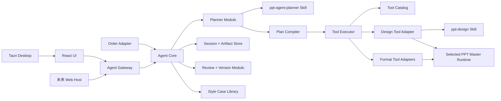
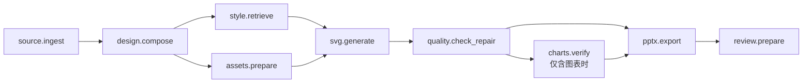

# PPT Agent V2 重构项目规划

> 实施状态：已完成，并于 2026-08-03 通过 Windows 安装版真实 DOCX 端到端验收。  
> 验收记录：[`ACCEPTANCE_REPORT.md`](./ACCEPTANCE_REPORT.md)

> 文档状态：已确认并完成  
> 编写日期：2026-08-03  
> 新项目根目录：`E:\OfficeAgent\ppt-agent-v2`  
> 旧版本目录：`E:\OfficeAgent\apps\ppt-agent-*`、`E:\OfficeAgent\backend\ppt_agent`、`E:\OfficeAgent\backend\ppt-master`

## 1. 项目目标

PPT Agent V2 是一次隔离式重构，不在旧版本上继续叠加兼容逻辑。V2 将建立一个真正由大模型规划、由类型化工具执行、可以在桌面和 Web 之间迁移的 PPT 智能体。

V2 必须满足以下目标：

1. 在独立目录中开发、测试和构建，旧版本在 V2 验收前保持可运行。
2. 保持现有 React UI 的视觉和交互不变，V2 通过兼容的 Gateway 接口接入。
3. 初次生成保持端到端运行，从用户提交到 `review_ready` 之间不询问设计偏好。
4. 用户只在 Review 阶段选择整份修改、指定页面修改、接受或回退版本。
5. 由通用 `ppt-agent-planner` Skill 生成可校验的执行计划。
6. 只有具体设计、SVG 生成和视觉修复步骤加载 `ppt-design` Skill。
7. 将 PPT Master 的工作流拆成 Agent 可组合的子工作流，而不是继续调用一个不可见的大流程。
8. 允许复制并改造 PPT Master 中成熟的确定性代码，但不照搬原始总 Skill、交互方式和运行时结构。
9. 页面预览由应用自身完成，不启动 `svg_editor/server.py`，不打开浏览器或额外终端。
10. Windows Release 安装后直接运行，不要求用户安装或配置 Python。

## 2. 非目标

本次重构不包含：

- 重新设计 React UI。
- 修改现有毛玻璃、圆角、布局和交互视觉规范。
- 在初次生成期间加入用户确认步骤。
- 将所有子工作流实现成独立的大模型 Agent。
- 让 Planner 直接执行 Python、Shell 或任意文件操作。
- 继续使用旧 Codex runner 作为 V2 的核心。
- 在 V2 验收前删除或覆盖旧项目。
- 将旧项目的历史任务、缓存和 SQLite 数据直接迁入 V2。

## 3. 新旧版本隔离原则

### 3.1 目录隔离

所有 V2 新代码、测试、文档、运行数据和构建输出必须位于：

```text
E:\OfficeAgent\ppt-agent-v2\
```

V2 不得通过相对路径导入以下旧版源码：

```text
..\backend\ppt_agent
..\backend\ppt-master
..\apps\ppt-agent-ui
..\apps\ppt-agent-desktop
```

允许在迁移阶段执行一次性复制，但复制后的代码归 V2 自己维护，运行时不得回退读取旧目录。

### 3.2 数据隔离

开发态默认数据目录：

```text
ppt-agent-v2/.data/
```

Windows 安装态默认数据目录：

```text
%LOCALAPPDATA%\OfficeAgent\PPTAgentV2\
```

会话、Artifact、版本、日志、临时文件和运行时解压目录均使用 V2 专属路径。禁止与旧版共用 SQLite 文件。

### 3.3 进程与端口隔离

- V2 sidecar 使用独立进程名和运行时版本号。
- 开发测试使用随机 loopback 端口。
- 不启动 PPT Master 的 Flask 预览进程。
- V2 的运行、取消和退出只能管理 V2 自己启动的进程。

### 3.4 迁移切换

旧版本一直保留到 V2 满足完整验收标准。达到验收标准后，通过桌面壳的 sidecar 配置切换到 V2；旧版删除或归档必须另行确认。

## 4. 许可证与代码复制规则

`backend/ppt-master` 使用 MIT License，因此允许复制、修改和再分发。V2 复制其代码时必须：

1. 在 `THIRD_PARTY_NOTICES.md` 中保留原版权与 MIT License。
2. 记录每个复制模块的原始路径、复制日期和后续主要改动。
3. 只复制实际需要的模块及其依赖，不复制整个仓库。
4. 复制后更换 PPT Master 专用路径、CLI 假设、预览服务和交互约定。
5. 使用行为测试证明改造前后的关键转换结果兼容。

“允许复制”不等于“直接照搬架构”。可复制的是稳定算法和格式处理实现；Planner、状态、Artifact、Review、错误协议和应用集成必须由 V2 自己实现。

## 5. 目标目录结构

```text
ppt-agent-v2/
├── apps/
│   ├── ppt-agent-ui/                 # 验收阶段原样复制现有 React UI
│   └── ppt-agent-desktop/            # Tauri 壳；UI 不改，仅切换 V2 sidecar
├── backend/
│   └── ppt_agent/
│       ├── core/                      # 会话、运行、状态机、ReAct 调度
│       ├── domain/                    # 计划、步骤、Artifact、Review、错误模型
│       ├── planning/                  # LLM Planner 与确定性 Plan Compiler
│       ├── skills/                    # V2 内置 Skill Loader
│       ├── tools/                     # Tool Catalog、Executor、工具 Adapter
│       ├── providers/                 # 可替换模型供应商 Adapter
│       ├── gateway/                   # UI 使用的稳定 HTTP/SSE 接口
│       ├── review/                    # 整份/指定页面修订与版本管理
│       ├── storage/                   # SQLite 与 Artifact Store
│       └── style_library/             # 完整 PPT 案例风格库
├── skills/
│   ├── ppt-agent-planner/
│   │   ├── SKILL.md
│   │   ├── agents/openai.yaml
│   │   └── references/
│   │       ├── plan-contract.md
│   │       ├── workflow-selection.md
│   │       └── recovery-policy.md
│   └── ppt-design/
│       ├── SKILL.md
│       ├── agents/openai.yaml
│       └── references/
│           ├── design-contract.md
│           ├── layout-and-style.md
│           ├── svg-authoring.md
│           └── quality-repair.md
├── vendor/
│   └── ppt_master_runtime/            # 经过筛选和改造的确定性实现
├── resources/
│   ├── templates/
│   ├── icons/
│   └── style-cases/
├── deploy/
│   └── windows/                       # PyInstaller、Tauri、NSIS/MSI 构建
├── tests/
│   ├── unit/
│   ├── contract/
│   ├── integration/
│   ├── acceptance/
│   └── fixtures/
├── docs/
│   ├── PROJECT_PLAN.md
│   ├── ARCHITECTURE.md
│   ├── WORKFLOWS.md
│   └── ACCEPTANCE.md
├── pyproject.toml
└── THIRD_PARTY_NOTICES.md
```

## 6. 总体架构



架构以三个深模块为中心：

1. **Planner Module**：把用户目标和可用工具编译成有效计划。
2. **Tool Executor**：隐藏脚本、超时、重试、检查点和 Artifact 细节。
3. **Review Module**：统一处理预览、整份修改、页面修改、版本与接受操作。

前端只使用 Gateway interface，不理解 Skill、脚本或 PPT Master 内部目录。

## 7. Planner Skill 设计

### 7.1 定位

`ppt-agent-planner` 是通用 PPT 任务规划 Skill。它负责决定“做什么、按什么顺序做、每一步需要什么 Artifact”，不负责“页面具体长什么样”。

Planner 的外部 interface：

```text
plan(PlanningContext, ToolSummary[]) -> ExecutionPlanDraft
```

Plan Compiler 的外部 interface：

```text
compile(ExecutionPlanDraft, ToolCatalog) -> ExecutionPlan
```

LLM 输出只能作为 Draft。只有通过 Plan Compiler 的计划才能执行。

### 7.2 PlanningContext

```json
{
  "goal": "根据论文生成一份12页中文汇报PPT",
  "conversation_summary": "...",
  "attachments": ["artifact://source/1"],
  "user_options": {
    "pages": 12,
    "language": "zh-CN"
  },
  "available_artifacts": [],
  "review_request": null,
  "constraints": {
    "interaction_policy": "review_only",
    "max_replans": 2
  }
}
```

### 7.3 ExecutionPlan

```json
{
  "schema": "ppt-agent.execution-plan.v1",
  "goal": "根据论文生成一份12页中文汇报PPT",
  "route": "document_to_ppt",
  "assumptions": [
    "听众为研究生",
    "使用16:9画布"
  ],
  "steps": [
    {
      "id": "source",
      "tool": "source.ingest",
      "depends_on": [],
      "input_bindings": {"files": "$request.attachments"},
      "expected_artifacts": ["source_bundle"]
    }
  ]
}
```

### 7.4 Plan Compiler 必须校验

- 工具存在、版本可用且成熟度允许执行。
- 工具输入满足 Schema。
- 步骤 ID 唯一。
- 依赖存在且 DAG 无环。
- Artifact 的生产者先于消费者。
- 初次生成计划最终包含 `review.prepare`。
- 初次生成不得包含阻塞式用户交互。
- 不得调用未注册脚本、Shell 或任意路径。
- 设计步骤必须在 SourceBundle 可用之后执行。
- 导出只能消费通过质量门的 SVG Deck。
- Planner 不得插入旧 `live_preview` 或 `svg_editor.server`。

### 7.5 降级策略

当模型不可用、返回非法 JSON 或连续两次无法通过编译时，使用确定性默认计划。降级计划仍通过同一个 Plan Compiler，不绕过质量门。

## 8. PPT Design Skill 设计

### 8.1 加载条件

只有以下工具允许加载 `ppt-design`：

- `design.compose`
- `svg.generate`
- `quality.visual_review`
- `quality.repair_page`
- `deck.revise_design`

`source.ingest`、`pptx.export`、`review.prepare` 等确定性工具不得加载设计 Skill。

### 8.2 从 PPT Master 保留的设计知识

- 受众、用途、语言和叙事目标分析。
- 内容大纲、逐页 brief、页面角色和节奏规划。
- 画布、颜色、字体、留白、安全区和信息密度规则。
- 通用、咨询和高阶咨询风格的差异。
- 图片布局、裁切、引用和版权约束。
- SVG/PPTX 兼容特性与禁用特性。
- 图表数值忠实性和坐标检查。
- 案例风格库的检索、借鉴和来源记录。
- 符号检查与视觉检查双通道。
- 面向 LLM 的结构化错误和定向修复方式。

### 8.3 不迁移的旧规则

- 八项设计确认及其他生成前阻塞交互。
- 浏览器 Live Preview 自动启动。
- 角色切换输出标记。
- Codex 主 Agent、子 Agent 和聊天窗口约束。
- 逐条展示给用户的内部检查点。
- 裸 Shell 命令和仓库相对路径。
- 强制 `--move` 用户源文件。
- 重新打开聊天继续执行的 split mode。
- 将整个生成过程固化在一个 `SKILL.md` 中。

### 8.4 渐进式加载

`ppt-design/SKILL.md` 只保存核心流程和引用导航。详细规则按步骤加载：

| 当前工具 | 加载引用 |
|---|---|
| `design.compose` | `design-contract.md`、`layout-and-style.md` |
| `svg.generate` | `svg-authoring.md`，以及当前页面需要的布局/图表参考 |
| `quality.visual_review` | `quality-repair.md` 的视觉检查部分 |
| `quality.repair_page` | `quality-repair.md` 的错误码对应修复部分 |

Planner 的上下文中不包含这些设计引用。

## 9. Tool Catalog

### 9.1 核心工具

| Tool | 主要输入 | 主要产物 | 是否加载设计 Skill |
|---|---|---|---:|
| `source.ingest` | 文件、文本、URL | `SourceBundle` | 否 |
| `research.prepare` | 主题、约束 | `ResearchBrief` | 否 |
| `template.inspect` | PPTX 模板 | `TemplateContext` | 否 |
| `template.fill` | 模板、SourceBundle | `FilledPptx` | 否 |
| `design.compose` | SourceBundle、TemplateContext | `DesignPackage` | 是 |
| `style.retrieve` | DesignPackage | `StyleReferenceSet` | 否 |
| `assets.prepare` | DesignPackage | `AssetManifest` | 否 |
| `svg.generate` | DesignPackage、StyleReferenceSet、AssetManifest | `SvgDeck` | 是 |
| `quality.check_repair` | SvgDeck | `VerifiedSvgDeck`、`QualityReport` | 条件加载 |
| `charts.verify` | VerifiedSvgDeck | `ChartReport` | 否 |
| `pptx.export` | VerifiedSvgDeck、Notes | `PptxArtifact` | 否 |
| `review.prepare` | PPTX、SVG、QualityReport | `ReviewPackage` | 否 |
| `deck.revise` | ReviewRequest、父版本 | 新版本 Artifact | 条件加载 |

### 9.2 显式可选工具

- `audio.generate`
- `animations.customize`
- `template.create`
- `brand.create`

这些工具只能在用户明确要求时进入计划，或在 Review 阶段由用户选择。

### 9.3 工具统一 interface

```text
run(ToolContext, TypedInput) -> ToolResult

ToolResult:
  status: succeeded | failed | cancelled
  artifacts: ArtifactRef[]
  observation: structured object
  metrics: duration / tokens / retries
  error: ErrorEnvelope | null
  checkpoint: CheckpointRef | null
```

每个工具只返回 Artifact 引用，不把大型文档、SVG 或图片直接塞回 Planner 上下文。

## 10. PPT Master 代码选择与改造

### 10.1 第一批复制

以下实现成熟、确定性较强，计划复制到 `vendor/ppt_master_runtime` 后改造：

- `source_to_md/`：PDF、DOCX、PPTX、Excel、网页转换。
- `pptx_to_svg/`：模板与现有 PPT 解析。
- `template_import/`：模板导入和 manifest。
- `template_fill_pptx/`：原生模板填充。
- `svg_finalize/`：图片、图标、圆角和文本后处理。
- `svg_to_pptx/`：DrawingML 与 PPTX 导出。
- `svg_quality_checker.py`：确定性 SVG 检查。
- `svg_repair.py`：可以结构化调用的修复逻辑。
- `latex_render.py`：公式素材生成。
- `total_md_split.py`：讲稿拆分。
- 必要的图片、图表、音频和动画实现。

### 10.2 必须重写或封装

| 旧实现 | V2 处理 |
|---|---|
| `project_manager.py` | 重写为 Workspace/Artifact 模块，不移动用户原文件 |
| CLI 入口 | 改为可注入依赖、可返回结构化结果的 Python interface |
| `SKILL.md` | 不复制；重新编写 Planner 和 Design Skill |
| Strategist/Executor prompt | 按 V2 Artifact 契约、Review 策略和错误协议重写 |
| 工作流状态 | 由 Agent Core 管理，不使用 PPT Master JobStore 作为真相源 |
| 脚本错误文本 | 转换为统一 `ErrorEnvelope` |
| 绝对/相对路径推导 | 通过 V2 ResourceLocator 统一解析 |
| 预览 | 由 Gateway 和 React UI 完成 |

### 10.3 不复制到 V2 运行时

- `scripts/svg_editor/server.py`
- `scripts/svg_editor/static/`
- `workflows/live-preview.md`
- `workflows/resume-execute.md`
- `scripts/update_repo.py`
- 与仓库维护、示例生成相关的开发脚本
- PPT Master 的 JobStore、HTTP 服务和旧交互协调器
- 原始完整 Skill 与不再使用的 Chat/Codex 约定

## 11. 默认 Document-to-PPT 组合



执行期间：

1. 信息不足时记录 `ProductionAssumption` 并继续。
2. 质量问题优先确定性修复，再执行元素 Patch、单页重生或局部重规划。
3. 不创建 `waiting_user`。
4. 技术硬阻塞进入 `failed` 或 `blocked_technical`，并保留检查点和 Artifact。
5. 成功导出后注册 SVG 页面预览和 PPTX，进入 `review_ready`。

## 12. Review 与版本

```text
deck_v1
  -> whole-deck review request
  -> deck_v2
  -> selected-pages review request [3, 5]
  -> deck_v3
```

Review Module 必须支持：

- 接受当前版本。
- 整份修改。
- 指定一个或多个页面修改。
- 页面级要求覆盖全局要求。
- 未选中页面保持 Artifact 不变。
- 新版本保留 `parent_id`、修改范围、页码和指令。
- 修改失败时仍可使用父版本。
- 回退或接受任意有效版本。

## 13. 应用内预览

正常生成流程不再启动任何 PPT Master 预览脚本。

```text
SvgDeck
  -> Artifact Store 注册 page_preview_vN_XXX
  -> Gateway 以 image/svg+xml + inline 返回
  -> React UI 使用现有  预览
```

要求：

- 不启动 Flask。
- 不占用 5050–5060 端口。
- 不打开浏览器。
- 不依赖本机 PowerPoint。
- Gateway 校验 Artifact 所属会话和访问令牌。
- PPTX 等下载文件仍使用 attachment；页面 SVG 使用 inline。

## 14. 前端保持不变的含义

V2 不修改当前 UI 的：

- 页面布局。
- 毛玻璃材质。
- Apple 风格圆角。
- 对话区、进度区和 Review 区布局。
- 工作流卡片和版本操作方式。
- 设置 API Key 的交互。

V2 Gateway 必须兼容现有 UI 使用的 HTTP 数据结构。允许修改桌面壳的 sidecar 路径、进程名、运行时解压路径和环境变量，但不修改 UI 视觉源代码。

在最终隔离时，当前 UI 源码原样复制到 `ppt-agent-v2/apps/ppt-agent-ui`，然后用源码 checksum 验证复制前后一致。

## 15. 结构化错误与 AI 修复

```json
{
  "kind": "quality",
  "code": "svg.text_overflow",
  "step": "svg.generate",
  "location": {
    "page": 6,
    "element_id": "body-2",
    "bbox": [120, 180, 560, 420]
  },
  "cause": "正文超过安全区28px",
  "correction": {
    "allowed": ["shorten_copy", "resize_text_box", "reduce_font_size"],
    "forbidden": ["delete_required_claim", "rewrite_unaffected_pages"],
    "acceptance": "元素底边必须位于y=392以内"
  },
  "retryable": true
}
```

修复优先级：

1. 确定性兼容修复。
2. 元素级受约束 Patch。
3. 单页重新生成。
4. 受影响页面的局部重规划。
5. 整份重新规划。

LLM 不接收“出错了”这种无定位信息。每次修复都必须知道错误位置、原因、允许修改范围、禁止动作和验收条件。

## 16. 模型供应商

V2 保留统一 ModelProvider interface：

```text
complete_json(system, prompt, schema)
complete_messages(messages)
review_image(image, prompt)
generate_image(request)
```

规划、设计、视觉检查和图片生成可以使用不同模型配置。密钥只存在于 sidecar 进程或 Windows Credential Manager，不返回前端、不写日志、不进入 Artifact。

## 17. 实施阶段

### Phase 0：规划确认

- 确认本规划文档。
- 冻结 V2 目录和新旧隔离规则。
- 明确首个端到端验收样本。

交付：已确认的 `PROJECT_PLAN.md`。

### Phase 1：项目骨架与契约

- 初始化 V2 Python 项目、测试目录和 Windows 构建目录。
- 建立 Domain Model、Tool Contract、Artifact Contract、ErrorEnvelope。
- 建立 Tool Catalog 和成熟度模型。
- 建立 Gateway 兼容契约测试。

验收：无真实模型时，Fake Adapter 能完成会话到 `review_ready`。

### Phase 2：Planner 与 Skills

- 创建 `ppt-agent-planner`。
- 创建 `ppt-design`。
- 实现 Skill Loader、Planner 和 Plan Compiler。
- 增加非法计划、缺失依赖、循环依赖和未成熟工具测试。

验收：模型计划和确定性降级计划均能通过同一 Compiler；Planner 上下文不包含设计 Skill。

### Phase 3：PPT Master 代码迁移

- 按复制清单迁移确定性模块。
- 添加许可证和来源记录。
- 将 CLI 改成类型化 Python interface。
- 使用旧版 Fixture 做行为兼容测试。
- 删除新运行时对旧目录的导入。

验收：文档转换、SVG 检查、后处理和 PPTX 导出均在 V2 目录内独立运行。

### Phase 4：端到端工具链

- 接入 source、design、style、assets、SVG、quality、export、review 工具。
- 实现检查点、有限重试和结构化修复。
- 实现完整 Artifact provenance。

验收：使用真实 DOCX 生成可读 PPTX，并进入 `review_ready`。

### Phase 5：预览、Review 与 UI 接入

- 实现 SVG inline Artifact 路由。
- 完成整份和指定页面修订。
- 原样复制 UI 和 Tauri 壳。
- Tauri 改为启动 V2 sidecar。

验收：UI checksum 保持一致；应用内可预览页面、修改版本和下载 PPTX；无浏览器预览进程。

### Phase 6：Windows 打包与最终验收

- 构建无控制台 PyInstaller sidecar。
- 只打包筛选后的资源和运行代码。
- 构建 Tauri Release、NSIS 和 MSI。
- 在不依赖系统 Python 的安装态执行完整生成。

验收：安装后直接运行，API Key 可配置，工作流可读取，真实文档生成成功，应用内预览正常。

## 18. 测试策略

### 18.1 Unit

- Plan Compiler。
- Artifact 绑定。
- DAG 排序。
- 错误转换。
- Skill 引用选择。
- 页面级修订范围。

### 18.2 Contract

- 每个 Tool 的输入输出 Schema。
- Gateway 与现有 UI 的响应兼容。
- ModelProvider 的 Fake/真实 Adapter 一致性。
- V2 与复制前 PPT Master 算法的关键行为一致性。

### 18.3 Integration

- SourceBundle 到 DesignPackage。
- SvgDeck 到 VerifiedSvgDeck。
- VerifiedSvgDeck 到 PPTX。
- Artifact 注册到应用内预览。
- ReviewRequest 到新 DeckVersion。

### 18.4 Acceptance

至少覆盖：

1. DOCX → PPTX。
2. PDF → PPTX。
3. 主题研究 → PPTX。
4. PPTX 模板引导生成。
5. 图片密集型 PPT。
6. 整份 Review 修改。
7. 指定页面 Review 修改。
8. 图表页坐标验证。
9. 模型返回非法计划后的协议修复或降级。
10. Windows 安装态无 Python 运行。

真实 provider 验收记录必须包含模型、时间、Fixture、Artifact checksum、质量门结果和实现 checksum，但不得包含 API Key。

## 19. 首个可验收目标

使用用户现有 DOCX 作为 Source Material，在 V2 Release 应用中完成：

```text
提交文件
  -> Planner 生成并编译计划
  -> 自动读取和设计
  -> 逐页生成 SVG
  -> 自动质量检查与定向修复
  -> 导出 PPTX
  -> 应用内显示所有页面
  -> 进入 review_ready
  -> 指定一页修改
  -> 生成新版本并保留旧版本
```

整个初次生成过程中不弹出浏览器、不打开终端、不询问用户设计问题、不依赖旧版源码目录。

## 20. Definition of Done

V2 只有同时满足以下条件才算完成：

- 新项目可以脱离旧目录构建和运行。
- Planner 是 LLM 驱动且输出必须经过 Plan Compiler。
- Planner 只看到精简 Tool Summary，不读取设计 Skill。
- `ppt-design` 只在设计相关步骤加载。
- 所有可执行工具都有类型化输入、输出和验收证据。
- 初次生成没有设计确认型 `waiting_user`。
- Preview 完全在应用内完成。
- 整份和指定页面 Review 均创建可回退的新版本。
- 结构化错误能指导 LLM 定向修复。
- 现有 UI 的视觉和交互保持不变。
- Windows 安装后无需 Python 和命令行配置。
- Release 应用使用真实模型完成至少一次端到端生成。
- 文档、测试、构建命令和许可证记录完整。

## 21. 风险与控制

| 风险 | 控制措施 |
|---|---|
| 一次复制过多旧代码 | 使用复制清单和依赖审计，按 Tool 迁移 |
| 新旧目录隐式耦合 | 测试时临时隐藏旧目录，验证 V2 独立运行 |
| LLM 计划不可执行 | Plan Compiler、白名单和确定性降级 |
| Skill 上下文重新膨胀 | Planner/Design 分离，按引用渐进加载 |
| 页面生成质量下降 | 保留成熟 SVG 约束、案例库和双通道质量检查 |
| PyInstaller 遗漏资源 | 构建期生成资源 manifest，安装态做 checksum smoke test |
| UI 兼容性破坏 | Gateway contract test + UI 源码 checksum |
| Review 修改误伤其他页面 | Artifact 不变性检查与页面级 checksum |
| 复制代码许可证遗漏 | `THIRD_PARTY_NOTICES.md` 和来源清单作为构建门 |

## 22. 后续文档

本规划确认后，再按实施顺序创建：

- `docs/ARCHITECTURE.md`：最终模块、interface、seam 和数据流。
- `docs/WORKFLOWS.md`：Tool Catalog 与组合计划。
- `docs/ACCEPTANCE.md`：测试命令、证据和已知限制。
- `THIRD_PARTY_NOTICES.md`：复制代码的许可证与来源。

在本规划确认前，不创建 V2 代码骨架，不复制旧代码，也不修改现有 UI。
